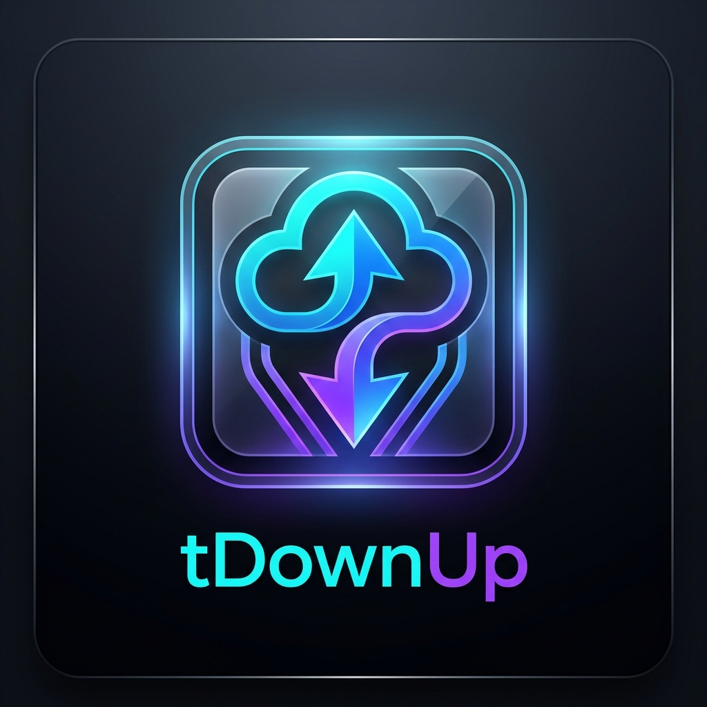

<p align="center">
  
</p>

<h1 align="center">⚡ tDownUp</h1>

<p align="center">
  <b>High-Speed Torrent & Magnet to Direct Cloud Transfer Telegram Bot</b><br>
  <i>Direct live in-memory transfer pipe to Buzzheavier, Gofile, and VikingFile with zero permanent disk footprint!</i>
</p>

<p align="center">
  <a href="https://t.me/tDownUpLzbot" target="_blank">
    
  </a>
</p>

---

## 🤖 Try the Live Bot

Experience **tDownUp** directly on Telegram right now without installing anything:

👉 **[@tDownUpLzbot](https://t.me/tDownUpLzbot)** 👈

---

## 📖 What is tDownUp?

**tDownUp** is an ultra-fast Telegram Bot built with Python (`pyTelegramBotAPI`) and Node.js (`WebTorrent`) that enables users to convert BitTorrent magnet links or `.torrent` files directly into high-speed direct download links on **[Buzzheavier.com](https://buzzheavier.com)**, **[Gofile.io](https://gofile.io)**, and **[VikingFile.com](https://vikingfile.com)**.

The bot features a **pure live RAM transfer relay** — BitTorrent chunks are piped directly to the cloud storage API without writing temporary files to local disk.

---

## 📥 How to Use

1. **Send a Torrent**:
   - Send `/dw <magnet_link>`
   - Or paste any magnet link directly (`magnet:?xt=...`)
   - Or send a `.torrent` file directly
   - Or reply to any `.torrent` file with `/dw`

2. **Select Files**:
   - The bot inspects the torrent contents and presents an interactive file checklist.
   - Tap any file to toggle it on (`✅`) or off (`❌`).
   - Use **`Select All`** or **`Deselect All`** for fast selection.

3. **Choose Destination**:
   - Tap **`🐝 Buzzheavier.com`**, **`📁 Gofile.io`**, or **`⚔️ VikingFile.com`**.

4. **Live Transfer Dashboard**:
   - Watch live transfer speed, progress bar, ETA, and connected peer count.
   - Click **`🛑 Stop Transfer`** at any time with safe confirmation.

5. **Unified Completion Card**:
   - Receive direct download links in a single unified message bubble with a native scrollable table.
   - Batches with 2+ files automatically include an attached batch `_Links.txt` file at the top containing all file page links.
   - Single-file transfers cleanly display without redundant text file attachments.
   - Supports large torrents up to 1,000 files seamlessly.

---

## 🛡️ Fair-Use Quotas & Limits

Applied automatically to maintain server stability and fair bandwidth distribution:

- 🔒 **Single Concurrent Transfer:** A user cannot start another transfer until their active transfer finishes.
- 🔢 **Daily Torrents Quota:** Up to **5 torrents per day** per user.
- 📦 **Max Single File Size:** Maximum **40 GB** for any single file.
- 🌐 **Daily Bandwidth Limit:** Up to **100 GB** total bandwidth per day across all torrents.
- ⏰ **Daily Reset:** Quotas reset automatically every day at `00:00 UTC`.

---

## ✨ Architecture & Core Features

### 🚀 Direct Live RAM Streaming (Zero Disk Footprint)
- BitTorrent pieces are held in an in-memory sliding window and streamed straight to cloud storage HTTP sockets.
- No temporary files are saved to the server's hard drive or SSD.
- Supports files up to 40 GB with strict memory caps (~64 MB – 100 MB RAM).

### 📄 Unified Rich Completion Bubble
- Merges the batch `.txt` document, torrent transfer metadata, and expandable file list table into **one single message bubble**.
- Telegram native vertical and horizontal scrolling without manual bot pagination buttons.
- Smart preview limits: Displays the first 100 files in the inline table while embedding all 1,000 files in the `.txt` document.

### 🐙 Local-First GitHub Cloud Database
- **Zero local `config.json`**: All settings and user database sync in real-time to a private GitHub repository (`database.json`).
- **Local-First Speed:** Loads from GitHub on startup, operates instantly from local RAM, and pushes changes automatically every 2 minutes.
- **Admin-Only Gatekeeper:** Locks safely in Admin-Only mode until a valid GitHub database token is configured.

### ⚙️ Covert Admin Control Panel (`/settings` or `/panel`)
Accessible exclusively by the configured `ADMIN_ID`:
- **🐙 Database:** Connect, test, refresh, or inspect GitHub Cloud Database synchronization.
- **📢 Channels:** Configure Bot Channel (force-join verification), Invite Link, Results Channel (broadcast completed transfers), and Error Channel.
- **⏱️ Quotas & Limits:** Configure daily torrent limits, max file sizes, and daily bandwidth limits.
- **☕ Donation Methods:** Configure PayPal, Binance Pay ID, and crypto addresses (USDT TRC20, BEP20, Solana, TON, ERC20, Arbitrum, opBNB).
- **👥 Members Management:** Search users, view stats, ban/unban members, and reset daily quotas.
- **📢 Broadcast:** Send announcements to all registered users simultaneously.

---

## 🐧 Linux Server & VPS Deployment

**tDownUp** is 100% cross-platform with zero external binary dependencies. To run on any Linux VPS or server (Ubuntu, Debian, CentOS):

```bash
# 1. Clone repository
git clone https://github.com/OBITOLZ0X/torrent-to-direct-download-by-lz.git
cd torrent-to-direct-download-by-lz

# 2. Install dependencies
pip install -r requirements.txt
npm install

# 3. Start the bot
python bot.py
```

---

## 📦 Standalone Windows Executable (`tDownUp.exe`)

The entire project (Python runtime, Node.js, WebTorrent transfer engine, and icon) compiles into a **single standalone file**:

```text
dist/tDownUp.exe
```

### Build Instructions:
```bash
python build_exe.py
```
Or double-click `build.bat`.
